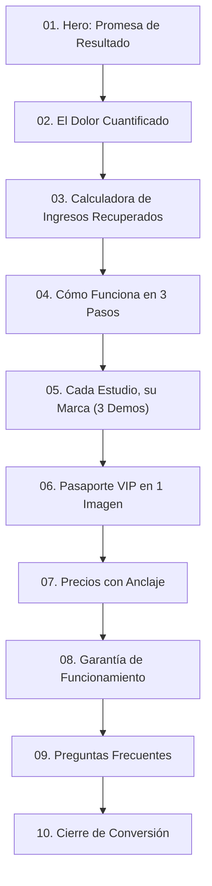

# DOCUMENTO DE ARQUITECTURA: DISEÑO DE AUTOR VANESEV, IDENTIDAD «CIRUELA IMPERIAL», SISTEMA DE MOVIMIENTO Y GOBERNANZA DE TEMAS

- **Documento:** `docs/DISENO_AUTOR_VANESEV.md`
- **Proyecto:** VANESEV (`vanesev.com`)
- **Autoría:** Antigravity (bajo dirección y supervisión de Claude Code, con la voz de mando de karc0)
- **Fecha:** 26 de Octubre de 2026 (Versión 2 - Corregida según RESPUESTA 2000 §3)
- **Estado:** PENDIENTE DE REVISIÓN Y APROBACIÓN DE CLAUDE CODE (Ninguna pantalla se construye antes del visto bueno)

---

## 0. Filosofía y Espíritu de Marca

### 0.1 Audiencia y Psicología
VANESEV vende a **dueñas de estudios de belleza**: pestañas, uñas, cejas, peluquería y estética clínica (las barberías se atienden en una zona única y puntual).
Estas empresarias compran **estética, confianza, orden y estatus**. El diseño de VANESEV debe transmitir:
- Sofisticación, elegancia, limpieza y lujo sin caer en lo frío ni en lo artificial.
- Autoridad y potencia de una *maison* de alta cosmética internacional.
- Cero aspecto de web tecnológica de nave espacial o plantilla genérica de SaaS de IA.

### 0.2 Prohibiciones Estrictas en VANESEV (Web, Central y Admin)
- **Fondo:** Queda terminantemente prohibido el modo oscuro («dark mode»), fondos negros o grises de terminal. Los fondos son **siempre claros y luminosos**.
- **Colores prohibidos en la marca:** Cero arcoíris, cero degradados multicolores, cero marrón/cognac/terracota, cero tonos pastel infantiles, **cero cualquier rosa** (fucsia, chicle, salmón o palo) y cero cremas/beiges apagados de catálogo.
- **Iconografía prohibida:** Cero iconografía mágica de IA (destellos ✦, `Sparkles`, varitas `Wand`, estrellas `Stars`, robots o "magia").
- **Estructuras prohibidas:** Cero rejillas genéricas de 3 tarjetas con icono arriba y texto, cero *glassmorphism* desmedido y cero etiquetas flotantes que tapen el cristal o el contenido.
- **Aislamiento:** La marca VANESEV no arrastra ningún color, tipografía ni elemento visual de ningún cliente ni de ningún otro proyecto.

### 0.3 Principio Metodológico
**No se destruye lo construido:** Se conserva la lógica viable del producto, el 100% del movimiento funcional previo (`framer-motion`), y se eleva a estándar de alta gama sobre la infraestructura existente.

---

## 1. La Regla Madre: Dos Mundos Estrictamente Separados

| Mundo | Pantallas | Identidad Visual | Implementación Técnica |
|---|---|---|---|
| **Mundo 1: VANESEV** | Web comercial (Zona 1), Central Superadmin (Zona 2), Admin de Salón (Zona 3) y Staff (Zona 5) | **Identidad Corporativa «Ciruela imperial»** en fondo claro. Variación de densidad según la función. | Atributo raíz `[data-brand="vanesev"]`. Tokens CSS estrictos. |
| **Mundo 2: Los Estudios** | Catálogo PWA (Zona 4), Ficha pública, Ficha clienta VIP, Pasaporte VIP, QR y Pantalla Compartir | **Tema de Autor Propio** generado en el Studio de Temas y persistido en Neon DB. | Atributo raíz `[data-tenant="<slug>"]`. Variables inyectadas desde BD. |

### Reglas Técnicas de Aislamiento
1. **Admin del Salón con acento de marca:** La estructura del panel de administración pertenece a VANESEV («Ciruela imperial»). El estudio particular aparece exclusivamente como **acento puntual**: su logotipo, su nombre comercial y un chip con su color primario.
2. **Componentes compartidos libres de color propio:** Modales, avisos de cookies, botones flotantes de WhatsApp, pantallas de carga, formularios y alertas consumen exclusivamente variables CSS (`var(--color-...)`).
   - Dentro de un catálogo: adoptan la paleta del estudio.
   - En la web de venta, Central o Admin: adoptan la paleta «Ciruela imperial».
3. **Erradicación de paletas fijas globales:** Se desacopla de la base de VANESEV la antigua paleta global (*Silk Alabaster, Cashmere, Rose Quartz, Champagne, Espresso*). Los colores de Andrea Labrador Nails quedan encapsulados exclusivamente dentro de su tenant `[data-tenant="andrea-nails"]`.

---

## 2. Sistema de Diseño «Ciruela imperial» (Identidad Oficial VANESEV)

### 2.1 Tokens Oficiales de la ORDEN 1930 §2
Todos los fondos son porcelana limpia. Los textos utilizan una **tinta ciruela profunda** de alta densidad para garantizar legibilidad clínica y estatus visual.

| Token CSS | Valor HEX | Uso / Función Semántica |
|---|---|---|
| `--v-bg` | `#FBFAFC` | Fondo general de la página (porcelana fría) |
| `--v-surface` | `#FFFFFF` | Superficies de tarjetas, modales y barras |
| `--v-surface-2` | `#F4F2F7` | Fondos alternos, hover, barra lateral Central y Admin |
| `--v-line` | `#E4E2EA` | Filetes de 1px, bordes ultra-finos y separadores platino |
| `--v-ink` | `#24152B` | Texto titular, subtítulos y lectura principal (tinta ciruela) |
| `--v-muted` | `#6E6478` | Texto secundario, metadatos, etiquetas y ayudas |
| `--v-brand` | `#5B2A6E` | **Ciruela imperial:** Botón primario de acción (CTA) y acentos |
| `--v-brand-hover` | `#4A2159` | Estado hover / activo del CTA primario |
| `--v-brand-soft` | `#EEE7F2` | Chips activos, estados seleccionados, tinte sutil |
| `--v-platinum` | `#B9BCC6` | Separadores de lujo, filetes editoriales y marcas de agua |
| `--v-ok` | `#1F7A5A` | Confirmación, citas agendadas, éxito |
| `--v-warn` | `#B26A00` | Avisos de agenda, límites próximos |
| `--v-danger` | `#B3261E` | Alertas críticas, errores, cancelaciones |

> [!IMPORTANT]
> **Corrección aplicada respecto a versiones anteriores:**
> Se erradica por completo el CTA magenta inventado `#7D328C` y la superficie `#F3EFF7`. Existe **un solo color de acción:** `--v-brand: #5B2A6E` (hover `--v-brand-hover: #4A2159`), y la superficie oficial es `--v-surface: #FFFFFF`.

### 2.2 Cálculo Oficial de Contraste WCAG 2.1
Calculado rigurosamente mediante la fórmula estándar W3C/WCAG 2.1 de luminancia relativa ($L = 0.2126 R + 0.7152 G + 0.0722 B$ en espacio lineal sRGB) y ratio $(L_1 + 0.05) / (L_2 + 0.05)$.
Comando generador ejecutable en el repositorio:
```powershell
node scripts/wcag-contrast.cjs
```

**Matriz de Contraste Real:**

| Elemento / Token | Color HEX | Contraste vs `--v-bg` (`#FBFAFC`) | Contraste vs `--v-surface` (`#FFFFFF`) | Nivel WCAG 2.1 |
|---|---|---|---|---|
| `--v-ink` (Texto principal) | `#24152B` | **16.58:1** | **17.25:1** | **AAA (Excelente)** |
| `--v-brand-hover` (Hover CTA) | `#4A2159` | **12.21:1** | **12.70:1** | **AAA (Excelente)** |
| `--v-brand` (Ciruela imperial CTA) | `#5B2A6E` | **10.08:1** | **10.49:1** | **AAA (Excelente)** |
| `--v-danger` (Alertas críticas) | `#B3261E` | **6.28:1** | **6.54:1** | **AA (Cumple)** |
| `--v-muted` (Texto secundario) | `#6E6478` | **5.37:1** | **5.59:1** | **AA (Cumple)** |
| `--v-ok` (Confirmación / éxito) | `#1F7A5A` | **5.06:1** | **5.26:1** | **AA (Cumple)** |
| `--v-warn` (Avisos de agenda) | `#B26A00` | **4.07:1** | **4.24:1** | **AA (Texto Grande / UI)** |
| `--v-platinum` (Filetes / sellos) | `#B9BCC6` | **1.82:1** | **1.90:1** | **Estructural / Separador** |
| Texto `#FFFFFF` sobre `--v-brand` | `#FFFFFF` | — | **10.49:1** | **AAA (Excelente)** |

### 2.3 Sistema Tipográfico
Google Fonts con licencia de código abierto:
- **Titulares y Maison Display:** `Cormorant Garamond` (pesos 500 Medium y 600 SemiBold). Interlineado generoso, tracking refinado.
- **Interfaz y Texto Corrido:** `Manrope` (pesos 400 Regular, 500 Medium, 600 SemiBold). Diseñada para pantallas táctiles y máxima legibilidad en párrafos densos.
- **Cifras y Datos Numéricos (Central y Admin):** `Manrope` con la regla obligatoria `font-variant-numeric: tabular-nums` para evitar saltos o desalineaciones en balances y contadores.
- **Restricción:** Queda prohibido el uso de `Fraunces` dentro de la marca VANESEV (reservada para temas de los estudios).

### 2.4 Iconografía
Familia única: `Lucide React` con trazo estilizado `strokeWidth={1.5}`. Empleo exclusivamente utilitario (calendario, agenda, usuario, teléfono, ajustes). Prohibido cualquier icono que represente "magia" o IA (`Sparkles`, `Wand`, `Stars`).

---

## 3. Arquitectura y Copywriting de la Web Comercial (Zona 1)

Estructura de 10 secciones basada en psicología de venta de alta conversión:



### Detalle de Secciones y Copy:

1. **Hero de Maison:**
   - *Titular Cormorant:* «Tu estudio, con agenda llena y marca de autor.»
   - *Subtítulo Manrope:* «La suite de gestión que transforma tu salón de belleza en una marca de lujo. Carta interactiva por código QR, reservas directas por especialista y Pasaporte VIP que fideliza a tus clientas sin intermediarios.»
   - *CTAs:* Botón sólido ciruela «Quiero mi estudio en VANESEV» + enlace refinado «Ver un estudio real».
   - *Visual Hero:* Maqueta de smartphone en perspectiva 3D interactiva que exhibe el catálogo real de un estudio, limpio de etiquetas flotantes sobre el cristal.
2. **El Dolor Cuantificado:**
   - Análisis tangible de las fugas de dinero en salones: los huecos vacíos de última hora, los mensajes de WhatsApp que se responden tarde y las clientas que prueban otro salón por no tener ficha de fidelidad.
3. **Calculadora Interactiva de Ingresos Recuperados:**
   - Parámetros: [Puestos de trabajo activos] × [Ticket promedio USD] × [Citas perdidas por semana].
   - Fórmula visible: Muestra con cifras tabulares fluidas el importe mensual recuperable.
   - *Aclaración explícita:* Es una estimación financiera basada en optimización de agenda, no una promesa fija.
4. **Cómo Funciona en 3 Pasos (Escenas fijas con Scroll):**
   - 01. La clienta escanea tu carta QR en su mesa o accede desde Instagram.
   - 02. Elige especialista, servicio y hora con confirmación inmediata.
   - 03. Acumula sellos en su Pasaporte VIP en cada visita y vuelve siempre.
5. **«Cada estudio, su marca» (Diferencial Tecnológico):**
   - Selector interactivo en vivo con 3 salones de demostración reales con identidades opuestas:
     - *Estudio 01:* Cejas & Pestañas (Salvia & Platino).
     - *Estudio 02:* Uñas & Spa (Sage Verde Clínico).
     - *Estudio 03:* Salón de Estilismo & Barbería (Monocromo Grafito).
6. **Pasaporte VIP en una Imagen:**
   - La tarjeta de fidelización explicada en una infografía de alta resolución: cómo sustituye las tarjetas de cartulina por sellos infalsificables en el móvil de la clienta.
7. **Precios con Anclaje Visual:**
   - 3 Niveles (Boutique, Estudio de Autor, Cadena Multi-Sede). El nivel intermedio destacado como «Recomendado» con cálculo visible de ahorro anual.
8. **Garantía y Compromiso:**
   - Marcador formal en staging para el texto legal validado por karc0.
9. **Preguntas que Frenan la Venta:**
   - «¿Qué pasa si mis clientas no saben usar aplicaciones?» (No requiere descargas, funciona directo en navegador).
   - «¿Cómo paso mis clientas desde la libreta o WhatsApp?» (El equipo de soporte migra tu agenda inicial).
   - «¿Tengo permanencia o penalizaciones?» (Libertad total mes a mes).
10. **Cierre de Conversión:**
    - Formulario minimalista de 4 campos (Nombre, Salón, Ciudad, WhatsApp) y botón de contacto directo a WhatsApp corporativo.
    - Barra fija inferior en móvil (Sticky Mobile Bar) con el CTA y el icono de WhatsApp visible, respetando el área segura (0px interferencia).
    - Homenaje sobrio a Vanessa integrado en el pie de página y en el Pasaporte VIP #001.

---

## 4. Bocetos de Central y Paneles de Control (Zonas 2, 3 y 5)

### 4.1 Central Superadmin (Zona 2 - karc0)
- **Superficie:** 100% fondos claros (`--v-bg` y `--v-surface`). Cero naranja y cero cabeceras oscuras.
- **Barra lateral:** Tinte platino `--v-surface-2` con enlaces nítidos a las secciones directivas (Ruta, Mis Tareas, Decisiones, Revisiones, Reportes DB, Buzón, Salones, Mapa Web).
- **Tablero Directivo:** Arriba, el "Siguiente del día" y las métricas maestras (Salones activos, MRR en USD, salud de infraestructura).
- **Tablas:** Tipografía `Manrope` con `tabular-nums`, bordes de 1px platino y badges de estado discretos (`--v-ok`, `--v-warn`, `--v-danger`).

### 4.2 Admin del Salón (Zona 3 - Dueña del Salón)
- **Enfoque financiero inmediato:** Lo primero que ve la empresaria es:
  - Ingresos del día y acumulado de la semana.
  - Citas pendientes de confirmar (botón de 1 toque a WhatsApp de la clienta).
  - Huecos libres de hoy y mañana con botón «Llenar este hueco» (mensaje pre-redactado para clientas VIP inactivas).
  - Clientas con 4/5 sellos a punto de canjear su beneficio.
- **Acceso:** Login formal titulado «Acceso del estudio · {Nombre del Salón}», campos «Correo» y «Contraseña» (eliminando referencias a "Super Admin").

### 4.3 Panel de Staff (Zona 5 - Especialistas y Recepción)
- Agenda del día organizada cronológicamente, ficha técnica de la siguiente clienta y validador de sello VIP. Cero métricas financieras.

---

## 5. El Generador de Diseño de los Estudios & Opciones para Capra Studio

### 5.1 Persistencia Servidor en Neon DB
Se erradica el almacenamiento en `localStorage`. Se crea la tabla `public.tenant_themes` en Neon vinculada al `tenant_id`:
- Campos: `tenant_id`, `palette_id`, `typography_id`, `layout_mode`, `motion_level`, `custom_tokens`, `updated_at`.
- Solo modificable por la dueña del salón autenticada con su sesión de admin (BLOQUE 2).

### 5.2 Cuatro Opciones de Tema de Autor para Capra Studio (San Cristóbal, Táchira)
Capra Studio (@caprastudio_ de María Giovanna Capra) está ubicado en **San Cristóbal (Táchira, Venezuela)**.
Para que karc0 elija la identidad definitiva sin que parezca un catálogo genérico de crema o marrón, y sin parecerse a la Ciruela imperial de VANESEV ni a Andrea Nails, se proponen **4 familias claras, luminosas y de alta costura**:

| Opción | Familia Estética | Color Primario | Acento / Filete | Fondo Luminoso | Superficie | Texto Tinta | Tipografía |
|---|---|---|---|---|---|---|---|
| **1. Salvia & Platino** | Botánica Botica de Lujo / Frescura Clínica | `#2B5948` (Verde salvia imperial) | `#D3DCD6` (Platino salvia) | `#F7F9F8` (Porcelana fría) | `#FFFFFF` | `#1A2A22` (Bosque noche) | `Cinzel` + `Plus Jakarta Sans` |
| **2. Ámbar & Champagne Frío** | Solar Noble / Alta Costura de Estudio | `#8A6518` (Oro ámbar pulido) | `#E5DFD1` (Arena fina) | `#FAFAF7` (Perla lino) | `#FFFFFF` | `#2B2519` (Carbón ámbar) | `Playfair Display` + `Inter` |
| **3. Cobalto Couture** | Zafiro Imperial / Joyería Europea | `#1B3B6F` (Azul zafiro corte) | `#D4DEE9` (Acero satinado) | `#F6F8FB` (Hielo zafiro) | `#FFFFFF` | `#111E33` (Zafiro noche) | `Italiana` + `Montserrat` |
| **4. Grafito Perla** | Titanio Editorial / Galería Suiza | `#2C3038` (Grafito de autor) | `#DFE1E5` (Platino neutro) | `#F9F9FA` (Nieve titanio) | `#FFFFFF` | `#181A1F` (Tinta mineral) | `DM Serif Display` + `Outfit` |

*Ninguna opción utiliza modo oscuro, ninguna utiliza rosa/fucsia, ninguna utiliza marrón/terracota y ninguna utiliza ciruela.*

---

## 6. Inventario Completo de Movimiento (Conserva y Eleva)

> [!NOTE]
> **Aclaración de Infraestructura 3D:**
> Se aclara que **Three.js nunca existió en el repositorio ni formó parte de las dependencias del proyecto**. Todo el movimiento del proyecto está implementado mediante `framer-motion` y CSS puro sobre GPU.

### Inventario Exhaustivo de las 35 Instancias de Movimiento en `src/`
Obtenido mediante análisis estático (`scratch/motion-inventory.cjs`) sobre los archivos fuente:

| # | Archivo y Línea | Elemento | Comportamiento Actual | Decisión | Motivo Técnico y Bloque |
|---|---|---|---|---|---|
| 1 | `src/components/AdminDashboard.tsx:1385` | `<motion.div>` | `whileHover={{ y: -2 }}` | **CONSERVAR** | Microinteracción sutil de elevación en tarjeta. Bloque D3. |
| 2 | `src/components/CapraStudioExperience.tsx:352` | `<motion.div>` | `initial={{ opacity: 0, y: 16 }}` | **CONSERVAR** | Entrada suave de hero de salón. Bloque D1. |
| 3 | `src/components/CapraStudioExperience.tsx:390` | `<motion.button>` | `whileHover={{ y: -2 }} whileTap={{ scale: 0.98 }}` | **CONSERVAR** | Feedback táctil háptico en botón de reserva. Bloque D1. |
| 4 | `src/components/CapraStudioExperience.tsx:448` | `<motion.div>` | `initial={{ opacity: 0, scale: 0.97 }}` | **CONSERVAR** | Entrada fluida de badge destacado sin layout shift. Bloque D1. |
| 5 | `src/components/CapraStudioExperience.tsx:492` | `<motion.div>` | `whileHover={{ y: -2 }}` | **CONSERVAR** | Elevación sutil en banner promocional. Bloque D1. |
| 6 | `src/components/CapraStudioExperience.tsx:703` | `<motion.article>` | `whileHover={{ y: -3 }}` | **CONSERVAR** | Hover de tarjeta de servicio en catálogo. Bloque D1. |
| 7 | `src/components/CapraStudioExperience.tsx:766` | `<motion.article>` | `whileHover={{ y: -4 }}` con spring | **CONSERVAR** | Transición física elástica en catálogo de cursos. Bloque D1. |
| 8 | `src/components/CapraStudioExperience.tsx:1139` | `<motion.div>` | `initial={{ opacity: 0 }} exit={{ opacity: 0 }}` | **CONSERVAR** | Fade de fondo oscuro en modal de servicio. Bloque D1. |
| 9 | `src/components/CapraStudioExperience.tsx:1146` | `<motion.div>` | `initial={{ scale: 0.95, y: 12 }}` | **CONSERVAR** | Entrada con escala sutil en modal de servicio. Bloque D1. |
| 10 | `src/components/CapraStudioExperience.tsx:1276` | `<motion.div>` | `initial={{ opacity: 0 }} exit={{ opacity: 0 }}` | **CONSERVAR** | Fade en overlay de drawer de filtros. Bloque D1. |
| 11 | `src/components/CapraStudioExperience.tsx:1283` | `<motion.div>` | `initial={{ x: '100%' }} exit={{ x: '100%' }}` | **CONSERVAR** | Drawer lateral nativo deslizante sobre GPU. Bloque D1. |
| 12 | `src/components/CapraStudioExperience.tsx:1425` | `<motion.div>` | `initial={{ opacity: 0 }} exit={{ opacity: 0 }}` | **CONSERVAR** | Fade en overlay de confirmación de reserva. Bloque D1. |
| 13 | `src/components/CapraStudioExperience.tsx:1432` | `<motion.div>` | `initial={{ scale: 0.95 }} exit={{ scale: 0.95 }}` | **CONSERVAR** | Escala en modal de confirmación de reserva. Bloque D1. |
| 14 | `src/components/CentralAuthGate.tsx:92` | `<motion.div>` | `initial={{ opacity: 0, y: 15 }}` | **MEJORAR** | Adaptar a tokens claros `--v-surface` de Ciruela Imperial. Bloque D1. |
| 15 | `src/components/CentralAuthGate.tsx:111` | `<motion.div>` | `initial={{ opacity: 0, scale: 0.95 }}` | **CONSERVAR** | Alerta y feedback visual de error de login. Bloque D1. |
| 16 | `src/components/CentralDashboard.tsx:582` | `<motion.div>` | `whileHover={{ y: -2 }}` | **CONSERVAR** | Hover de tarjeta KPI directiva. Bloque D3. |
| 17 | `src/components/CentralDashboard.tsx:1439` | `<motion.div>` | `whileHover={{ y: -3 }}` | **CONSERVAR** | Hover en tarjeta de salón en Central. Bloque D3. |
| 18 | `src/components/SalonThemeStudio.tsx:127` | `<motion.button>` | `whileHover={{ y: -2 }}` | **CONSERVAR** | Selección táctil de preset de tema. Bloque D1. |
| 19 | `src/components/VanesevLanding.tsx:384` | `<motion.div>` | `initial={{ opacity: 0, y: -10 }}` | **CONSERVAR** | Sticky header revelado en scroll. Bloque D2. |
| 20 | `src/components/VanesevLanding.tsx:456` | `<motion.div>` | `initial={{ opacity: 0, y: 24 }}` | **CONSERVAR** | Fade-in suave de titulares de Hero. Bloque D2. |
| 21 | `src/components/VanesevLanding.tsx:537` | `<motion.div>` | `initial={{ opacity: 0, x: -20 }}` | **MEJORAR** | Unificar con `prefers-reduced-motion` y stagger. Bloque D2. |
| 22 | `src/components/VanesevLanding.tsx:555` | `<motion.div>` | `initial={{ opacity: 0, x: 20 }}` | **MEJORAR** | Unificar con `prefers-reduced-motion` y stagger. Bloque D2. |
| 23 | `src/components/VanesevLanding.tsx:570` | `<motion.div>` | `initial={{ opacity: 0, x: -20 }}` | **MEJORAR** | Unificar con `prefers-reduced-motion` y stagger. Bloque D2. |
| 24 | `src/components/VanesevLanding.tsx:658` | `<motion.div>` | `initial={{ opacity: 0, x: 8 }}` | **CONSERVAR** | Cambio fluido entre pestaña de catálogo. Bloque D2. |
| 25 | `src/components/VanesevLanding.tsx:727` | `<motion.div>` | `initial={{ opacity: 0, x: 8 }}` | **CONSERVAR** | Cambio fluido a pestaña de pasaporte VIP. Bloque D2. |
| 26 | `src/components/VanesevLanding.tsx:771` | `<motion.div>` | `initial={{ opacity: 0, x: 8 }}` | **CONSERVAR** | Cambio fluido a pestaña de WhatsApp. Bloque D2. |
| 27 | `src/components/VanesevLanding.tsx:1105` | `<motion.div>` | `style={{ rotateX, scale: scale3d, transformPerspective: 1200 }}` | **MEJORAR** | Añadir clamp estricto a ±10° y desconexión en low-power. Bloque D2. |
| 28 | `src/components/VanesevLanding.tsx:1990` | `<motion.div>` | `initial={{ opacity: 0 }} exit={{ opacity: 0 }}` | **CONSERVAR** | Overlay de modal de acceso de clienta. Bloque D1. |
| 29 | `src/components/VanesevLanding.tsx:1997` | `<motion.div>` | `initial={{ scale: 0.95, y: 12 }}` | **CONSERVAR** | Diálogo modal de acceso de clienta. Bloque D1. |
| 30 | `src/components/VanesevLanding.tsx:2102` | `<motion.div>` | `initial={{ opacity: 0 }} exit={{ opacity: 0 }}` | **CONSERVAR** | Overlay de modal de demo Capra. Bloque D2. |
| 31 | `src/components/VanesevLanding.tsx:2109` | `<motion.div>` | `initial={{ scale: 0.95, y: 12 }}` | **CONSERVAR** | Diálogo de modal de demo Capra. Bloque D2. |
| 32 | `src/components/VanesevLanding.tsx:2187` | `<motion.div>` | `initial={{ opacity: 0 }} exit={{ opacity: 0 }}` | **CONSERVAR** | Overlay de modal de demo de agenda. Bloque D2. |
| 33 | `src/components/VanesevLanding.tsx:2194` | `<motion.div>` | `initial={{ scale: 0.95, y: 12 }}` | **CONSERVAR** | Diálogo de modal de demo de agenda. Bloque D2. |
| 34 | `src/components/VanesevLanding.tsx:2251` | `<motion.div>` | `initial={{ opacity: 0 }} exit={{ opacity: 0 }}` | **CONSERVAR** | Overlay de modal de confirmación demo. Bloque D2. |
| 35 | `src/components/VanesevLanding.tsx:2258` | `<motion.div>` | `initial={{ scale: 0.95 }} exit={{ scale: 0.95 }}` | **CONSERVAR** | Diálogo de confirmación demo. Bloque D2. |

---

## 7. Mapa de Movimiento de la Web de Venta (Zona 1)

| Sección | Elemento Dinámico | Disparador (Trigger) | Propiedades Animadas | Duración / Curva |
|---|---|---|---|---|
| **01. Hero** | Smartphone Preview 3D | Scroll vertical (`useScroll`) | `rotateX`, `rotateY` (max ±10°), `translateZ` | Vinculado al scroll (`easeOut`) |
| **01. Hero** | Titular Cormorant | Carga de página | `opacity`, revelado sutil | 600ms (`easeOut`) |
| **01. Hero** | CTA Ciruela | Hover del cursor | Brillo platino sutil en máscara `x: ['-100%', '100%']` | 600ms linear |
| **02. El Dolor** | Indicadores de Pérdida | Entrada en viewport (`whileInView`) | `opacity: [0, 1]`, `y: [10, 0]` | 400ms (`easeOut`) |
| **03. Calculadora** | Importe en USD | Input slider / botones | Contador numérico con `tabular-nums` | 300ms (`easeOut`) |
| **04. Pasos** | Pinned Scroll Scene | Scroll en contenedor de 300vh | Bloqueo de pantalla; cambio de imagen de producto | Vinculado al scroll |
| **05. Demos** | Transición de Salón | Clic en selector de pestañas | `opacity: [0.85, 1]`, cambio fluido de CSS tokens | 300ms (`easeInOut`) |
| **06. VIP Card** | Pasaporte 3D | Movimiento de ratón / Giroscopio | `rotateY: max 12deg`, `rotateX: max 8deg` | Spring damping: 25, stiffness: 150 |
| **07. Precios** | Toggle Anual/Mensual | Clic de usuario | Posición de pastilla pill y swap de cifras | 200ms (`easeOut`) |
| **Global** | Modales y Drawers | Apertura / Cierre | `opacity`, `scale: [0.98, 1]` | 200ms (`easeOut`) |

---

## 8. Estado y Directrices de Assets (Imagen y Vídeo)

### 8.1 Declaración Explícita de Estado (Conforme a RESPUESTA 2000 §3.3)
- **3 Imágenes de Campaña Editorial:** **NO HECHAS** (pendientes de generación bajo directrices editoriales).
- **Loop de Vídeo de Prueba (6–10s):** **NO HECHO** (planificado para Blob Storage).
- **Documento `docs/ASSETS.md`:** **NO HECHO** (se redactará y entregará en conjunto con los archivos reales generados).
- **Hoja de Contactos Fotográfica:** **NO HECHA** (se generará al completar la sesión fotográfica).

### 8.2 Especificación Artística para su Futura Generación
Cuando se autorice la generación de assets en el bloque correspondiente:
1. **Luz:** Luz natural diurna difusa de ventanal, estética clínica y limpia. Cero neón, cero fondos oscuros.
2. **Personas:** Clientas y profesionales latinas con piel real, textura de poros viva (cero aspecto render/plástico). Manos anatómicamente perfectas de 5 dedos con manicura impecable.
3. **Entornos:** Microcemento blanco, mármol Carrara, acero pulido y porcelana fría.
4. **Almacenamiento:** Formatos modernos WebP / AVIF (< 250 KB en Hero, < 150 KB secundarias) y vídeo en Vercel Blob (< 2 MB).

---

## 9. Presupuesto de Rendimiento y Accesibilidad

| Métrica | Umbral Exigido | Estrategia de Cumplimiento |
|---|---|---|
| **Lighthouse Rendimiento (Móvil)** | **≥ 85 / 100** | Sin librerías 3D pesadas (cero Three.js). Lazy loading nativo en imágenes y rutas secundarias. |
| **LCP (Largest Contentful Paint)** | **< 2.5 segundos** | Hero optimizado en AVIF/WebP (< 250 KB) con atributo `fetchpriority="high"`. |
| **CLS (Cumulative Layout Shift)** | **< 0.1** | Dimensiones explícitas `aspect-ratio` en todas las imágenes y contenedores. |
| **Hardware de Animación** | **Exclusivo GPU** | Se anima únicamente `transform` y `opacity`. Cero transiciones sobre `width`, `height`, `margin` o `box-shadow`. |
| **Accesibilidad `prefers-reduced-motion`** | **100% Soportado** | Si el usuario tiene reducción de movimiento activa en su sistema operativo, las animaciones se desactivan o se reducen a fundido instantáneo. |

---

## 10. Auditoría de Componentes con Colores Hardcodeados a Migrar (Bloque D1)

| Componente | Situación Actual | Acción en D1 |
|---|---|---|
| `src/components/CookieConsentBanner.tsx` | Contiene `#16291F` y `amber-400` de Andrea Nails | Migrar a `--v-surface` y `--v-brand` |
| `src/components/CentralDashboard.tsx` | Contiene acentos naranjas `#F26A3D` | Sustituir por Ciruela imperial `--v-brand` (`#5B2A6E`) |
| `src/components/AdminDashboard.tsx` | Contiene clases verdes de Andrea en el panel estructural | Adoptar estructura clara VANESEV con chip de salón |
| `src/components/AdminAuthGate.tsx` | Textos de "Super Admin" en acceso de salón de belleza | Corregir a "Acceso del estudio · {nombre}" |
| `src/components/WhatsAppHelpFloat.tsx` | Botón flotante blanco sin icono visible en móvil | Asegurar SVG nítido y herencia de tokens |
| `src/components/TokensDesignSystem.tsx` | Importaba `Sparkles` | Erradicado y sustituido |

---

## 11. Despliegue, Staging y Protección de `/__tokens`

1. **Ruta `/__tokens` protegida:**
   - La pantalla de visualización del sistema de diseño interactivo (`/__tokens`) está condicionada en `src/App.tsx` para responder **404 Not Found** si se consulta desde los dominios de producción `vanesev.com` o `www.vanesev.com`.
   - Solo está activa en entornos de vista previa / staging.
2. **Acceso a Staging para karc0:**
   - El despliegue de staging está protegido por Vercel Deployment Protection.
   - Enlace estable de la rama: `https://vanesev-platform-git-staging-vanesevapp-4342.vercel.app`.
   - Acceso seguro para karc0:
     a) Iniciar sesión en `vercel.com` con su cuenta autorizada del equipo `vanesevapp-4342` y abrir el enlace.
     b) O mediante Shareable Link generado desde el Dashboard de Vercel (Project $\rightarrow$ Settings $\rightarrow$ Deployment Protection).
     *(Sin publicar contraseñas ni secretos de bypass).*
