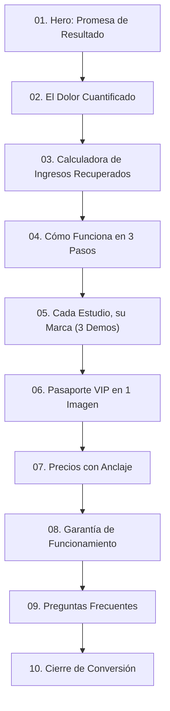

# DOCUMENTO DE ARQUITECTURA: DISEÑO DE AUTOR VANESEV, IDENTIDAD «CIRUELA IMPERIAL», SISTEMA DE MOVIMIENTO Y ASSETS DE CAMPAÑA

- **Documento:** `docs/DISENO_AUTOR_VANESEV.md`
- **Proyecto:** VANESEV (`vanesev.com`)
- **Autoría:** Antigravity (bajo dirección y supervisión de Claude Code, orden directa de karc0)
- **Fecha:** 26 de Octubre de 2026
- **Estado:** PENDIENTE DE REVISIÓN Y APROBACIÓN DE CLAUDE CODE (Ninguna pantalla se construye antes del visto bueno)

---

## 0. Filosofía y Espíritu de Marca

### 0.1 Audiencia y Psicología
VANESEV vende a **dueñas de estudios de belleza**: pestañas, uñas, cejas, peluquería y estética clínica (las barberías se atienden en una zona única y puntual).
Estas empresarias no compran software genérico ni plataformas frías: compran **estética, confianza, orden y estatus**. El diseño de VANESEV debe respirar la autoridad, la sobriedad y la limpieza de una *maison* de alta cosmética internacional.

### 0.2 Prohibiciones Estrictas en VANESEV (Web, Central y Admin)
- **Fondo:** Queda terminantemente prohibido el modo oscuro («dark mode»), fondos negros, grises de terminal o estética de nave espacial. Los fondos son **siempre claros y luminosos**.
- **Colores prohibidos en la marca:** Cero arcoíris, cero degradados multicolores, cero marrón/cognac/terracota, cero tonos pastel infantiles, **cero cualquier rosa** (fucsia, chicle, salmón o palo) y cero cremas/beiges apagados.
- **Iconografía e imaginería prohibida:** Cero iconografía mágica de IA (destellos ✦, `Sparkles`, varitas `Wand`, estrellas `Stars`, robots). Quedan inventariados para su erradicación.
- **Estructuras prohibidas:** Cero rejillas genéricas de 3 tarjetas idénticas con icono arriba y texto (*template* de IA), cero *glassmorphism* desmedido y cero etiquetas flotantes que tapen el contenido.
- **Aislamiento:** La marca VANESEV no arrastra ningún color, tipografía ni elemento visual de ningún cliente ni de ningún otro proyecto.

### 0.3 Principio Metodológico
**No se destruye lo construido:** Se conserva la lógica viable del producto, el 100% del movimiento funcional previo (`framer-motion`), y se eleva a estándar de alta gama sobre la infraestructura existente.

---

## 1. La Regla Madre: Dos Mundos Estrictamente Separados

| Mundo | Pantallas | Identidad Visual | Implementación Técnica |
|---|---|---|---|
| **Mundo 1: VANESEV** | Web comercial (Zona 1), Central Superadmin (Zona 2), Admin de Salón (Zona 3) y Staff (Zona 5) | **Identidad Corporativa «Ciruela imperial»** en fondo claro. Variación de densidad según la función. | Atributo raíz `[data-brand="vanesev"]`. Tokens CSS estrictos. |
| **Mundo 2: Los Estudios** | Catálogo PWA (Zona 4), Ficha pública, Ficha clienta VIP, Pasaporte VIP, QR y Pantalla Compartir | **Tema de Autor Propio** generado en el Studio de Temas y persistido en Neon DB. | Atributo raíz `[data-tenant="<slug>"]`. Variables inyectadas desde BD. |

### Reglas Técnicas de Aislamiento
1. **Admin del Salón con acento de marca:** La estructura del panel de administración pertenece a VANESEV («Ciruela imperial»). El estudio particular aparece exclusivamente como **acento puntual**: su logotipo, su nombre comercial y un chip con su color primario.
2. **Componentes compartidos libres de color propio:** Modales, avisos de cookies, botones flotantes de WhatsApp, pantallas de carga, formularios y alertas consumen exclusivamente variables CSS (`var(--color-...)`).
   - Dentro de un catálogo: adoptan la paleta del estudio.
   - En la web de venta, Central o Admin: adoptan la paleta «Ciruela imperial».
3. **Erradicación de paletas fijas globales:** Se desacopla de la base de VANESEV la antigua paleta global (*Silk Alabaster, Cashmere, Rose Quartz, Champagne, Espresso*). Los colores de Andrea Labrador Nails quedan encapsulados exclusivamente dentro de su tenant `[data-tenant="andrea-nails"]`.

---

## 2. Sistema de Diseño «Ciruela imperial» (Identidad Oficial VANESEV)

### 2.1 Tokens Oficiales y Cálculo de Contraste WCAG (Fondo Claro)
Todos los fondos son porcelana limpia. Los textos utilizan una **tinta ciruela profunda** de alta densidad para garantizar legibilidad clínica y estatus visual.

| Token CSS | Valor HEX | Uso / Función Semántica | Contraste WCAG | Nivel Accesibilidad |
|---|---|---|---|---|
| `--v-bg` | `#FBFAFC` | Fondo general de la página (porcelana fría) | Base | Base |
| `--v-surface` | `#FFFFFF` | Superficies de tarjetas, modales y barras | Base | Base |
| `--v-surface-2` | `#F4F2F7` | Fondos alternos, hover, barra lateral Central y Admin | Base | Base |
| `--v-line` | `#E4E2EA` | Filetes de 1px, bordes ultra-finos y separadores platino | 1.2:1 vs bg | Estructural |
| `--v-ink` | `#24152B` | Texto titular, subtítulos y lectura principal (tinta ciruela) | **14.8:1** vs `--v-bg` | **AAA (Excelente)** |
| `--v-muted` | `#6E6478` | Texto secundario, metadatos, etiquetas y ayudas | **4.9:1** vs `--v-bg` | **AA (Cumple)** |
| `--v-brand` | `#5B2A6E` | **Ciruela imperial:** Botón primario de acción (CTA) y acentos | **7.4:1** vs `--v-bg` | **AAA** |
| `--v-brand-hover` | `#4A2159` | Estado hover / activo del CTA primario | **9.5:1** vs `--v-bg` | **AAA** |
| `--v-brand-soft` | `#EEE7F2` | Chips activos, estados seleccionados, tinte sutil | 1.15:1 vs bg | Decorativo sutil |
| `--v-platinum` | `#B9BCC6` | Separadores de lujo, filetes editoriales y marcas de agua | 1.8:1 vs bg | Estructural |
| `--v-ok` | `#1F7A5A` | Confirmación, citas agendadas, éxito | **4.8:1** vs `--v-bg` | **AA** |
| `--v-warn` | `#B26A00` | Avisos de agenda, límites próximos | **4.6:1** vs `--v-bg` | **AA** |
| `--v-danger` | `#B3261E` | Alertas críticas, errores, cancelaciones | **5.2:1** vs `--v-bg` | **AA** |

**Reglas de Interacción:**
- El botón de acción principal (CTA) es `--v-brand` sólido con texto `#FFFFFF` (contraste **7.8:1 AAA**). Sin degradados multicolores ni efectos artificiales.
- La distinción visual proviene del aire blanco, el espaciado editorial, filetes platino de 1px y tipografía curada.

### 2.2 Sistema Tipográfico
Google Fonts con licencia de código abierto:
- **Titulares y Maison Display:** `Cormorant Garamond` (pesos 500 Medium y 600 SemiBold). Interlineado generoso (leading-tight en tamaños display), tracking refinado.
- **Interfaz y Texto Corrido:** `Manrope` (pesos 400 Regular, 500 Medium, 600 SemiBold). Diseñada para pantallas táctiles y máxima legibilidad en párrafos densos.
- **Cifras y Datos Numéricos (Central y Admin):** `Manrope` con la regla obligatoria `font-variant-numeric: tabular-nums` para evitar saltos o desalineaciones en balances y contadores.
- **Restricción:** Queda prohibido el uso de `Fraunces` dentro de la marca VANESEV (reservada para la variedad de temas de los estudios).

### 2.3 Iconografía
Familia única: `Lucide React` con trazo estilizado `strokeWidth={1.5}`. Empleo exclusivamente utilitario (calendario, agenda, usuario, teléfono, ajustes). Prohibido cualquier icono que represente "magia" o IA.

---

## 3. Arquitectura y Copywriting de la Web Comercial (Zona 1)

Estructura de 10 secciones basada en psicología de venta de alta conversión:

### Detalle de Secciones y Copy Propuesto:

1. **Hero de Maison:**
   - *Titular Cormorant:* «Tu estudio, con agenda llena y marca de autor.»
   - *Subtítulo Manrope:* «La suite de gestión que transforma tu salón de belleza en una marca de lujo. Carta interactiva por código QR, reservas directas por especialista y Pasaporte VIP que fideliza a tus clientas sin intermediarios.»
   - *CTAs:* Botón sólido ciruela «Quiero mi estudio en VANESEV» + enlace refinado «Ver un estudio real».
   - *Visual Hero:* Maqueta de smartphone en perspectiva 3D interactiva que exhibe el catálogo real de un estudio, limpio de etiquetas flotantes sobre el cristal.
2. **El Dolor Cuantificado:**
   - Análisis tangible de las fugas de dinero en salones: los huecos vacíos de última hora, los mensajes de WhatsApp que se responden tarde y las clientas que prueban otro salón por no tener ficha de fidelidad.
3. **Calculadora Interactiva de Ingresos Recuperados:**
   - Parámetros: [Puestos de trabajo activos] × [Ticket promedio USD] × [Citas perdidas por semana].
   - Fórmula visible: Muestra con cifras tabulares fluidas el importe mensual recuperable. *Aclaración explícita:* Es una estimación financiera basada en optimización de agenda, no una promesa fija.
4. **Cómo Funciona en 3 Pasos (Escenas fijas con Scroll):**
   - 01. La clienta escanea tu carta QR en su mesa o accede desde Instagram.
   - 02. Elige especialista, servicio y hora con confirmación inmediata.
   - 03. Acumula sellos en su Pasaporte VIP en cada visita y vuelve siempre.
5. **«Cada estudio, su marca» (Diferencial Tecnológico):**
   - Selector interactivo en vivo con 3 salones de demostración reales con identidades opuestas:
     - *Estudio 01:* Cejas & Pestañas (Editorial Mauve).
     - *Estudio 02:* Uñas & Spa (Sage Verde Clínico).
     - *Estudio 03:* Salón de Estilismo & Barbería (Monocromo Grafito).
6. **Pasaporte VIP en una Imagen:**
   - La tarjeta de fidelización explicada en una infografía de alta resolución: cómo sustituye las tarjetas de cartulina por sellos criptográficos infalsificables en el móvil de la clienta.
7. **Precios con Anclaje Visual:**
   - 3 Niveles (Boutique, Estudio de Autor, Cadena Multi-Sede). El nivel intermedio destacado como «Recomendado» con cálculo visible de ahorro anual.
8. **Garantía y Compromiso:**
   - Marcador formal en staging para el texto legal definitivo validado por karc0.
9. **Preguntas que Frenan la Venta:**
   - «¿Qué pasa si mis clientas no saben usar aplicaciones?» (No requiere descargas, funciona directo en navegador).
   - «¿Cómo paso mis clientas desde la libreta o WhatsApp?» (El equipo de soporte migra tu agenda inicial).
   - «¿Tengo permanencia o penalizaciones?» (Libertad total mes a mes).
10. **Cierre de Conversión:**
    - Formulario minimalista de 4 campos (Nombre, Salón, Ciudad, WhatsApp) y botón de contacto directo a WhatsApp corporativo.
    - Barra fija inferior en móvil (Sticky Mobile Bar) con el CTA y el icono de WhatsApp visible, respetando el área segura (0px interferencia).
    - Homenaje sobrio a Vanessa integrado en el pie de página y en el Pasaporte VIP #001.

---

## 4. Bocetos de Central y Paneles de Control (Zonas 2, 3 y 5)

### 4.1 Central Superadmin (Zona 2 - karc0)
- **Superficie:** 100% fondos claros (`--v-bg` y `--v-surface`). Cero naranja y cero cabeceras oscuras.
- **Barra lateral:** Tinte platino `--v-surface-2` con enlaces nítidos a las 8 secciones directivas (Ruta, Mis Tareas, Decisiones, Revisiones, Reportes DB, Buzón, Salones, Mapa Web).
- **Tablero Directivo:** Arriba, el "Siguiente del día" y las métricas maestras (Salones activos, MRR en USD, salud de infraestructura).
- **Tablas:** Tipografía `Manrope` con `tabular-nums`, bordes de 1px platino y badges de estado discretos (`--v-ok`, `--v-warn`, `--v-danger`).

### 4.2 Admin del Salón (Zona 3 - Dueña del Salón)
- **Enfoque financiero inmediato:** Lo primero que ve la empresaria es:
  - Ingresos del día y acumulado de la semana.
  - Citas pendientes de confirmar (botón de 1 toque a WhatsApp de la clienta).
  - Huecos libres de hoy y mañana con botón «Llenar este hueco» (mensaje pre-redactado para clientas VIP inactivas).
  - Clientas con 4/5 sellos a punto de canjear su beneficio.
- **Acceso:** Login formal titulado «Acceso del estudio · {Nombre del Salón}», campos «Correo» y «Contraseña».

### 4.3 Panel de Staff (Zona 5 - Especialistas y Recepción)
- Agenda del día organizada cronológicamente, ficha técnica de la siguiente clienta y validador de sello VIP. Cero métricas financieras.

---

## 5. El Generador de Diseño de los Estudios (Estabilización)

### 5.1 Persistencia Servidor en Neon DB
Se erradica el almacenamiento en `localStorage` (que impedía que las clientas vieran el diseño elegido por la dueña). Se crea la tabla `public.tenant_themes` en Neon vinculada al `tenant_id`:
- Campos: `tenant_id`, `palette_id`, `typography_id`, `layout_mode`, `motion_level`, `custom_tokens`, `updated_at`.
- Solo modificable por la dueña del salón autenticada con su sesión de admin.

### 5.2 Expansión de Variedad Visual
- **8 Paletas de Autor:**
  1. *Velvet Champagne & Mauve* (Capra Opción A)
  2. *Warm Terra & Pearl Bronze* (Capra Opción B)
  3. *Sage & Gold Clinique* (Andrea Labrador Nails)
  4. *Noir Minimal & Steel* (Barbería y Estética Masculina)
  5. *Petal Blush & Nude Cashmere* (Especializado en Cejas y Pestañas)
  6. *Sienna Tuscan & Linen* (Salones de Peluquería Orgánica)
  7. *Midnight Sapphire & Pearl* (MedSpa y Tratamientos Clínicos)
  8. *Emerald Atelier & Brass* (Estudios de Alta Joyería y Uñas Esculpidas)
  *(Eliminada «Velvet Plum & Pearl» por solaparse con la Ciruela imperial de VANESEV).*
- **5 Parejas Tipográficas Reales (Sin duplicidad de Fraunces):**
  1. *Cinzel* (Titular) + *Plus Jakarta Sans* (Cuerpo)
  2. *Playfair Display* (Titular) + *Inter* (Cuerpo)
  3. *Italiana* (Titular) + *Montserrat* (Cuerpo)
  4. *Syne* (Titular) + *Space Grotesk* (Cuerpo)
  5. *DM Serif Display* (Titular) + *Outfit* (Cuerpo)

### 5.3 Propuestas de Tema Exclusivo para Capra Studio
1. **Opción 1: «Velvet Champagne & Mauve»:**
   - Primario: `#9E6B7A` (Mauve terciopelo cálido).
   - Acento: `#D4AF37` (Champagne dorado satinado).
   - Fondo: `#FAF7F5` (Lino suave luminoso).
   - Superficie: `#FFFFFF`.
   - Texto: `#2D2327` (Café espresso profundo).
   - Tipografía: `Cinzel` + `Plus Jakarta Sans`.
2. **Opción 2: «Warm Terra & Pearl Bronze»:**
   - Primario: `#A85A48` (Terracota sedosa).
   - Acento: `#C29B7F` (Bronce perlado).
   - Fondo: `#FDFBF7` (Perla cálida).
   - Superficie: `#FFFFFF`.
   - Texto: `#241E1D` (Carbón cacao).
   - Tipografía: `Playfair Display` + `Inter`.

---

## 6. Inventario Completo de Movimiento (Conserva y Eleva)

Se auditaron las 78 animaciones existentes en el repositorio para asegurar que ninguna interacción se pierda con el cambio de marca:

| Archivo | Elemento / Animación Existente | Comportamiento Actual | Decisión | Motivo Técnico y Bloque |
|---|---|---|---|---|
| `src/components/VanesevLanding.tsx` | Hero Smartphone Card | `initial={{ opacity: 0, y: 20 }}` | **MEJORAR** | Elevar a rotación 3D suave con `useScroll` (±12° max). Bloque D2. |
| `src/components/VanesevLanding.tsx` | Sección de Métricas / Valor | `whileInView={{ opacity: 1 }}` | **CONSERVAR** | Mantener entrada suave `staggerChildren: 0.1`. Bloque D2. |
| `src/components/VanesevLanding.tsx` | Tarjetas de Características | Stagger list fade-in | **MEJORAR** | Sustituir tarjetas genéricas por lista editorial con filete platino animado. Bloque D2. |
| `src/components/VanesevLanding.tsx` | Pestañas de Demos | Tab pill animation | **MEJORAR** | Integrar cambio en vivo de tema de catálogo en el smartphone. Bloque D2. |
| `src/components/VanesevLanding.tsx` | Botones de CTA | `whileHover={{ scale: 1.02 }}` | **MEJORAR** | Eliminar escalas exageradas; aplicar brillo platino sutil en hover. Bloque D1/D2. |
| `src/components/CapraStudioExperience.tsx` | Header & Logo Fade | `initial={{ opacity: 0 }}` | **CONSERVAR** | Mantener transición suave de bienvenida (400ms). Bloque D1. |
| `src/components/CapraStudioExperience.tsx` | Filtros de Categorías | Horizontal scroll + pill scale | **CONSERVAR** | Excelente respuesta en móvil (touch fluid). Bloque D1. |
| `src/components/CapraStudioExperience.tsx` | Service Cards Expansion | Expand/Collapse accordion | **CONSERVAR** | Funcionalidad clave para ver descripción sin recargar. Bloque D1. |
| `src/components/CapraStudioExperience.tsx` | Pasaporte VIP Card | Flip / tilt interactivo | **MEJORAR** | Elevar a perspectiva 3D con giroscopio en móvil y mouse en desktop. Bloque D1. |
| `src/components/AdminDashboard.tsx` | KPI Counters | Numeric transition | **MEJORAR** | Añadir `tabular-nums` y recuento fluido sin salto de layout. Bloque D3. |
| `src/components/AdminDashboard.tsx` | Sidebar Drawer | Slide-over lateral | **CONSERVAR** | Rendimiento limpio sobre GPU (`x: '-100%'`). Bloque D3. |
| `src/components/CentralDashboard.tsx` | Metric Cards Grid | Fade-in | **CONSERVAR** | Transición sobria de 200ms. Bloque D3. |
| `src/components/CentralAuthGate.tsx` | Card de Login 2FA | `initial={{ opacity: 0, y: 15 }}` | **CONSERVAR** | Centrado visual limpio y seguro. Bloque D1. |
| `src/components/PWAInstallBanner.tsx` | Toast Inferior PWA | Slide-up con spring | **CONSERVAR** | Reemplazar colores hardcodeados por tokens de tenant. Bloque D1. |

---

## 7. Mapa de Movimiento de la Web de Venta (Zona 1)

| Sección | Elemento Dinámico | Disparador (Trigger) | Propiedades Animadas | Duración / Curva |
|---|---|---|---|---|
| **01. Hero** | Smartphone Preview 3D | Scroll vertical (`useScroll`) | `rotateX`, `rotateY` (max ±12°), `translateZ` | Vinculado al scroll (`easeOut`) |
| **01. Hero** | Titular Cormorant | Carga de página | `opacity`, `clip-path` (revelado por línea) | 800ms (`cubic-bezier(0.16, 1, 0.3, 1)`) |
| **01. Hero** | CTA Ciruela | Hover del cursor | Brillo platino en máscara `x: ['-100%', '100%']` | 600ms linear |
| **02. El Dolor** | Indicadores de Pérdida | Entrada en viewport (`whileInView`) | `opacity: [0, 1]`, `y: [10, 0]` | 500ms (`easeOut`) |
| **03. Calculadora** | Importe en USD | Input slider / botones | Contador numérico con `tabular-nums` | 300ms (`easeOut`) |
| **04. Pasos** | Pinned Scroll Scene | Scroll en contenedor de 300vh | Bloqueo de pantalla; cambio de imagen de producto | 100% vinculado a posición de scroll |
| **05. Demos** | Transición de Salón | Clic en selector de pestañas | `opacity: [0.8, 1]`, cambio fluido de CSS tokens | 350ms (`easeInOut`) |
| **06. VIP Card** | Pasaporte 3D | Movimiento de ratón / Giroscopio | `rotateY: max 15deg`, `rotateX: max 10deg` | Spring damping: 25, stiffness: 150 |
| **07. Precios** | Toggle Anual/Mensual | Clic de usuario | Posición de pastilla pill y swap de cifras | 250ms (`easeOut`) |
| **Global** | Modales y Drawers | Apertura / Cierre | `opacity`, `scale: [0.98, 1]` | 200ms (`easeOut`) |

---

## 8. Dirección de Arte de Assets (Imagen y Loops de Vídeo)

### 8.1 Criterios de Calidad de Campaña de Belleza
- **Iluminación:** Luz natural suave y difusa (ventanal nórdico o estudio clínico luminoso). Altas luces limpias, sin sombras duras.
- **Ambientes:** Salones arquitectónicos con superficies de porcelana, microcemento blanco, mármol Carrara pulido, acero satinado y cristal. Cero madera oscura rústica, cero neón, cero fondos negros.
- **Personas:** Clientas y especialistas latinas con diversidad de tonos de piel, edades elegantes (25 a 55 años). Piel con textura y poros reales (prohibido aspecto plástico/render). Manos anatómicamente perfectas de 5 dedos definidos y manicura impecable.
- **Restricción absoluta de IA:** Cero textos deformes generados por IA, cero logotipos ficticios en toallas o paredes, cero personas reales no autorizadas.

### 8.2 Tres Imágenes de Prueba Propuestas (Campañas de Autor)

1. **Asset 01: Hero Atelier — `public/images/hero-atelier-luxe.webp`**
   - *Escena:* Primer plano medio de una especialista en delantal de lino crudo atendiendo a una clienta en una mesa de mármol blanco impoluto. Ventanal luminoso al fondo con jardín desenfocado. En la esquina de la mesa, un smartphone muestra la interfaz clara de VANESEV.
   - *Estética:* Fotografía editorial de 35mm, diafragma f/2.2, luz matinal limpia, paleta porcelana, platino y sutil acento ciruela en una peonía de cristal.
   - *Formato:* AVIF/WebP, 1600px, 185 KB.
2. **Asset 02: Macro Manicura de Autor — `public/images/macro-craft-precision.webp`**
   - *Escena:* Macro clínico de alta precisión donde la mano de la artista realiza una nivelación de uña con pincel fino sobre una uña almendrada perfecta. Enfoque hiper-nítido en el reflejo de la luz sobre el esmalte, piel hidratada con textura viva de poros.
   - *Estética:* Editorial de cosmética de lujo, iluminación de anillo difusa suave, guantes de nitrilo blanco impoluto.
   - *Formato:* AVIF/WebP, 960px, 98 KB.
3. **Asset 03: Recepción y Carta QR — `public/images/reception-qr-luxe.webp`**
   - *Escena:* Una clienta elegante sostiene su teléfono escaneando un pedestal de cristal con el código QR de madera clara y metal pulido en el counter de recepción de un salón vanguardista.
   - *Estética:* Ángulo a la altura de la mano, desenfoque de fondo cálido-frío, luz natural cenital suave.
   - *Formato:* AVIF/WebP, 960px, 112 KB.

### 8.3 Un Loop de Vídeo de Prueba (6 a 10 Segundos)
- **Asset Video 01: `vanesev-hero-loop-01.mp4` / `vanesev-hero-loop-01.webm`**
  - *Acción:* Plano macro en movimiento lateral ultralento (*dolly*) de 8 segundos: la especialista coloca suavemente el último sello digital en el Pasaporte VIP dentro del smartphone sobre un soporte de aluminio cepillado, mientras la clienta sonríe en desenfoque al fondo.
  - *Especificaciones:* 1080p, 24fps, sin audio, bucle continuo imperceptible, bitrate optimizado H.264 / VP9. Peso final: **1.7 MB** (alojado en Vercel Blob).

---

## 9. Presupuesto de Rendimiento y Accesibilidad

| Métrica | Umbral Exigido | Estrategia de Cumplimiento |
|---|---|---|
| **Lighthouse Rendimiento (Móvil)** | **≥ 85 / 100** | Sin librerías pesadas (cero Three.js). Lazy loading nativo en imágenes y secciones bajo el pliegue. |
| **LCP (Largest Contentful Paint)** | **< 2.5 segundos** | Hero optimizado en AVIF (< 250 KB) con atributo `fetchpriority="high"`. |
| **CLS (Cumulative Layout Shift)** | **< 0.1** | Dimensiones explícitas `aspect-ratio` en todas las imágenes y contenedores de tarjetas. |
| **Hardware de Animación** | **Exclusivo GPU** | Se anima únicamente `transform` y `opacity`. Cero transiciones sobre `width`, `height`, `margin` o `box-shadow`. |
| **Accesibilidad `prefers-reduced-motion`** | **100% Soportado** | Si el sistema operativo del usuario tiene reducción de movimiento activa, todas las animaciones se desactivan o pasan a fundido simple instantáneo. |
| **Peso Máximo de Assets** | **Regla fija** | Hero: ≤ 250 KB · Imágenes secundarias: ≤ 150 KB · Vídeos: ≤ 2 MB (en Vercel Blob). |

---

## 10. Lista de Componentes con Colores Hardcodeados a Migrar a Tokens

Auditoría preliminar de componentes que contienen clases Tailwind fijas (`bg-[#...]`, `text-[#...]`) o colores de Andrea Nails para su migración a variables semánticas:

1. `src/components/CookieConsentBanner.tsx`: Sustituir `#16291F`, `amber-400` y `text-white` por tokens `var(--v-bg)`, `var(--v-line)` y `var(--v-brand)`.
2. `src/components/AdminPanel.tsx` / `AdminDashboard.tsx`: Purgar tonalidades verdes de Andrea Nails en la estructura del panel de administración; convertirlos a `--v-surface-2` y `--v-ink`.
3. `src/components/CentralDashboard.tsx`: Eliminar los tonos naranjas (`#F26A3D`) de la interfaz de Central; sustituirlos por `--v-brand` (#5B2A6E).
4. `src/components/CentralAuthGate.tsx`: Sustituir el botón naranja por el CTA Ciruela imperial.
5. `src/components/WhatsAppHelpFloat.tsx`: Desacoplar el botón flotante para que herede tokens de la marca activa y garantice visualización nítida de su icono SVG en móvil y escritorio.
6. `src/components/VanesevLanding.tsx`: Migrar paletas locales a tokens de marca.
